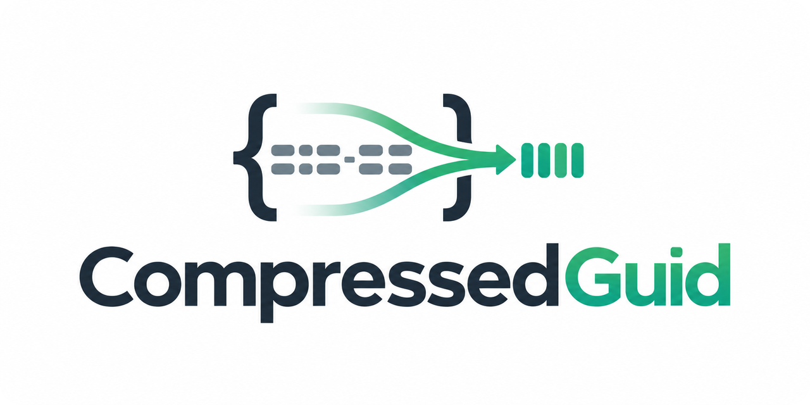
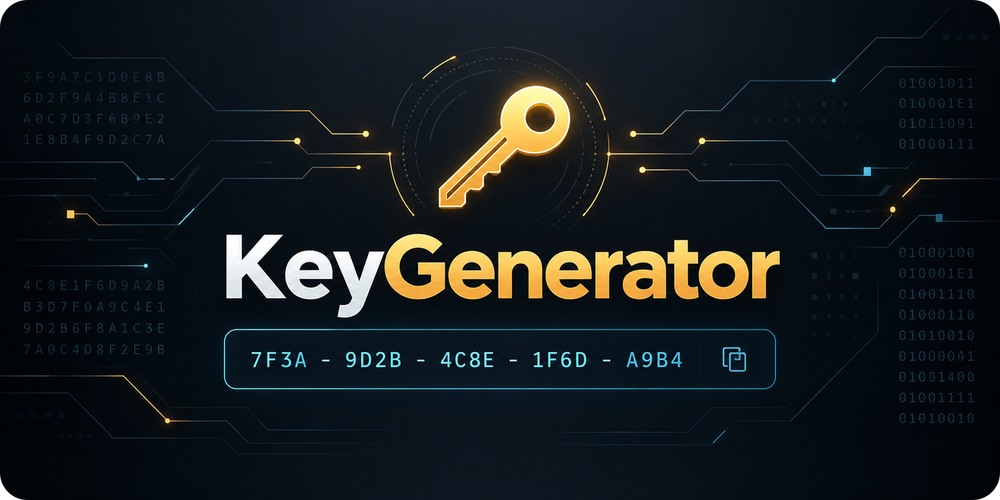
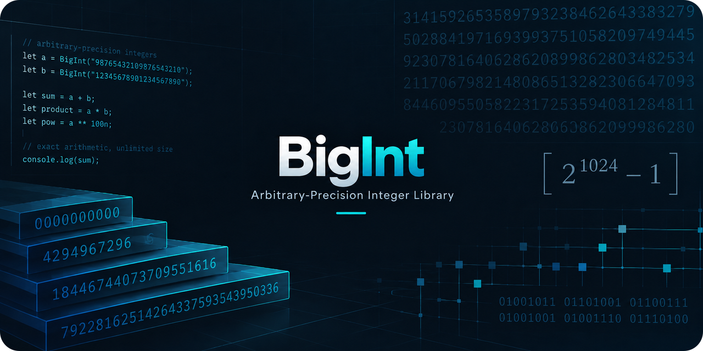
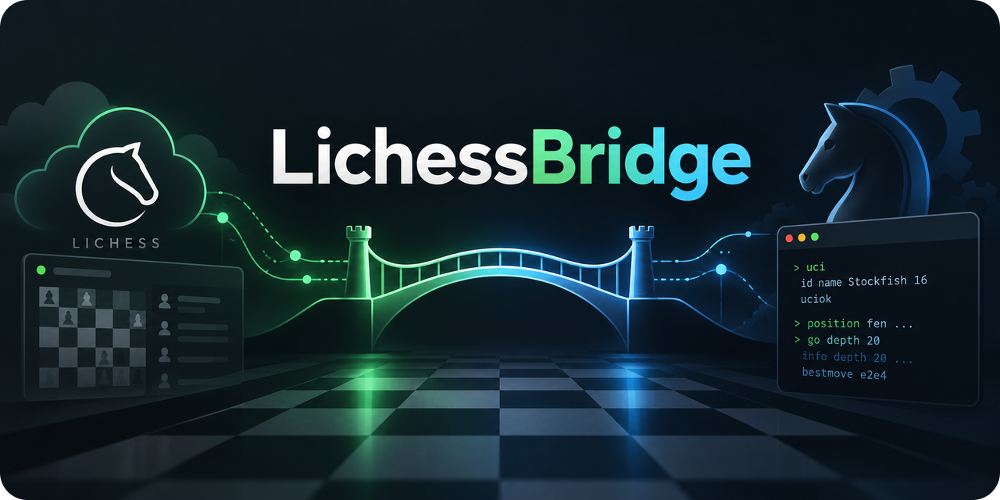

  <h1>Projects & Experiments</h1>
  
<strong>.NET &nbsp;·&nbsp; C# &nbsp;·&nbsp; Developer Tools &nbsp;·&nbsp; Algorithms</strong>

  
Practical libraries, focused utilities, and a few fun technical challenges.

  

    <a href="https://github.com/Iceeman76?tab=repositories">All repositories</a>
    &nbsp;·&nbsp;
    <a href="https://www.dotnetlab.se/">Interactive playground</a>
  

### Libraries & Fundamentals

  &nbsp;
  

- **[Json](https://github.com/Iceeman76/Json)** — A navigable JSON tree with JSONPath-like queries, builders and field extraction.
- **[CompressedGuid](https://github.com/Iceeman76/CompressedGuid)** — Compact, URL-safe, 22-character GUIDs with an immutable, thread-safe API.

  &nbsp;
  

- **[KeyGenerator](https://github.com/Iceeman76/KeyGenerator)** — Create and validate signed tokens with strongly typed payloads and HMAC signatures.
- **[BigInt](https://github.com/Iceeman76/BigInt)** — Calculating π with BigInteger: comparing algorithms, timing and precision.

### Tools & Integrations

  &nbsp;
  

- **[LichessBridge](https://github.com/Iceeman76/LichessBridge)** — Connect a WinBoard/2 chess engine to Lichess Bot games, with live analysis and controls.
- **[M3UProxy](https://github.com/Iceeman76/M3UProxy)** — A local M3U, XMLTV and Xtream-compatible proxy for sources used with authorization.

### Puzzles & Algorithms

  

- **[Sudoku](https://github.com/Iceeman76/Sudoku)** — A high-performance Sudoku solver combining logical deduction, backtracking and parallel batch solving.

### More to explore

**[DepSniff](https://github.com/Iceeman76/DepSniff)** — A .NET command-line tool for finding redundant or unused NuGet packages and project references, using Roslyn and MSBuild.

  Explore the code, open an issue, or contribute to a project that interests you.

