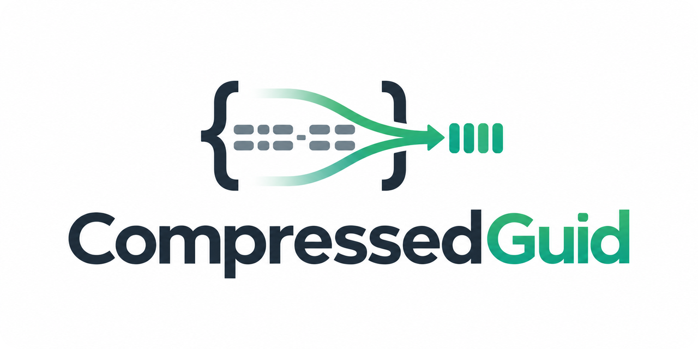
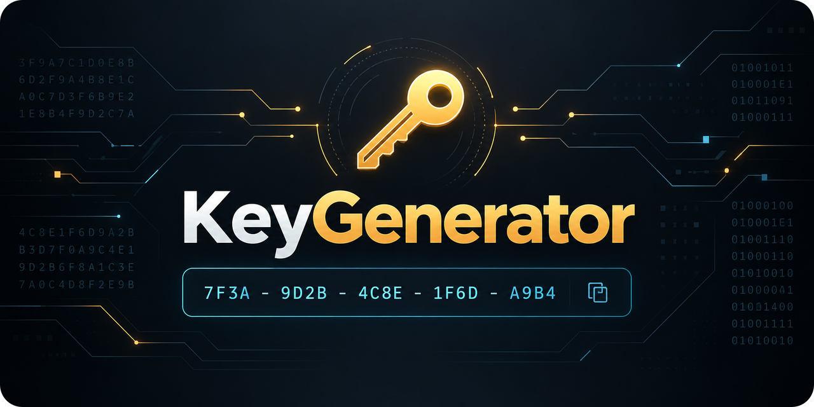
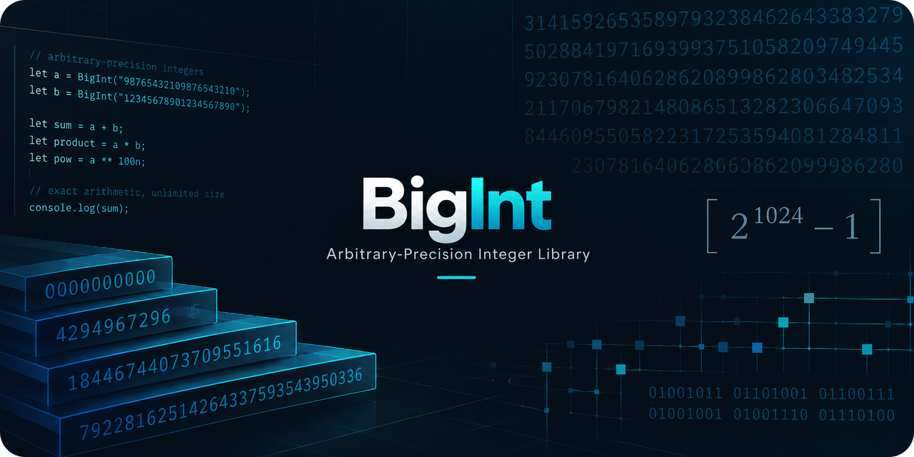
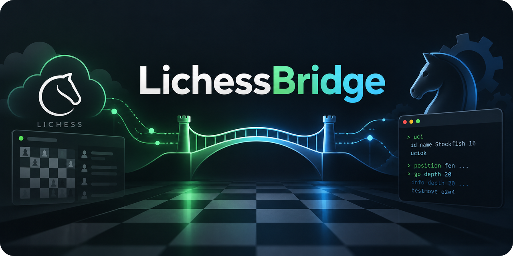

  <h1>Projects & Experiments</h1>
  
<strong>.NET &nbsp;·&nbsp; C# &nbsp;·&nbsp; Developer Tools &nbsp;·&nbsp; Algorithms</strong>

  
Practical libraries, focused utilities, and a few fun technical challenges.

  

    <a href="https://github.com/Iceeman76?tab=repositories">All repositories</a>
    &nbsp;·&nbsp;
    <a href="https://www.dotnetlab.se/">Interactive playground</a>
  

### Featured repositories

<table>
  <tr>
    <td width="50%" valign="top">
      
      <strong><a href="https://github.com/Iceeman76/Json">Json</a></strong> 
      A navigable JSON tree with JSONPath-like queries, builders and field extraction.
    </td>
    <td width="50%" valign="top">
      
      <strong><a href="https://github.com/Iceeman76/CompressedGuid">CompressedGuid</a></strong> 
      Compact, URL-safe, 22-character GUIDs with an immutable, thread-safe API.
    </td>
  </tr>
  <tr>
    <td width="50%" valign="top">
      
      <strong><a href="https://github.com/Iceeman76/KeyGenerator">KeyGenerator</a></strong> 
      Create and validate signed tokens with strongly typed payloads and HMAC signatures.
    </td>
    <td width="50%" valign="top">
      
      <strong><a href="https://github.com/Iceeman76/BigInt">BigInt</a></strong> 
      Calculating π with BigInteger: comparing algorithms, timing and precision.
    </td>
  </tr>
  <tr>
    <td width="50%" valign="top">
      
      <strong><a href="https://github.com/Iceeman76/LichessBridge">LichessBridge</a></strong> 
      Connect a WinBoard/2 chess engine to Lichess Bot games, with live analysis and controls.
    </td>
    <td width="50%" valign="top">
      
      <strong><a href="https://github.com/Iceeman76/M3UProxy">M3UProxy</a></strong> 
      A local M3U, XMLTV and Xtream-compatible proxy for sources used with authorization.
    </td>
  </tr>
  <tr>
    <td width="50%" valign="top">
      
      <strong><a href="https://github.com/Iceeman76/Sudoku">Sudoku</a></strong> 
      A high-performance Sudoku solver combining logical deduction, backtracking and parallel batch solving.
    </td>
    <td width="50%" valign="top">
      <strong><a href="https://github.com/Iceeman76/DepSniff">DepSniff</a></strong> 
      A .NET command-line tool for finding redundant or unused NuGet packages and project references, using Roslyn and MSBuild.
    </td>
  </tr>
</table>

  Explore the code, open an issue, or contribute to a project that interests you.

