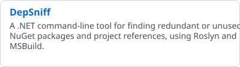

  <h1>Projects & Experiments</h1>
  
<strong>.NET &nbsp;·&nbsp; C# &nbsp;·&nbsp; Developer Tools &nbsp;·&nbsp; Algorithms</strong>

  
Practical libraries, focused utilities, and a few fun technical challenges.

  

    <a href="https://github.com/Iceeman76?tab=repositories">All repositories</a>
    &nbsp;·&nbsp;
    <a href="https://www.dotnetlab.se/">Interactive playground</a>
  

### Featured repositories

  &nbsp;
  

  &nbsp;
  

  &nbsp;
  

  &nbsp;
  

  Explore the code, open an issue, or contribute to a project that interests you.

